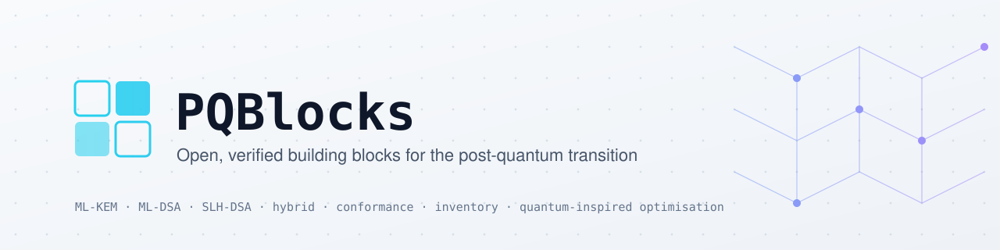
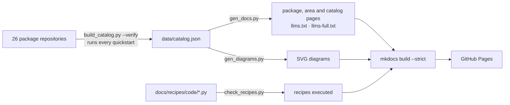

<p align="center">
  <picture>
    <source media="(prefers-color-scheme: dark)" srcset="docs/assets/banner-dark.svg">
    
  </picture>
</p>

# pqblocks.github.io

Source of **[pqblocks.github.io](https://pqblocks.github.io)**, the documentation site of the PQBlocks organisation: verified building blocks for post-quantum cryptography, migration, interoperability, conformance and quantum-inspired optimisation.

## How the site stays correct



| Path | What it is | Edit by hand? |
|---|---|---|
| `data/catalog.json` | Package facts, built by `pqblocks-mcp/scripts/build_catalog.py --verify` | No, regenerate |
| `docs/packages/*.md`, `docs/llms*.txt`, `docs/includes/quickstart/` | Generated by `scripts/gen_docs.py` | No |
| `docs/assets/diagrams/*.svg` | Generated by `scripts/gen_diagrams.py` | No |
| `docs/recipes/code/*.py` | Recipe programs, included verbatim in the recipe pages | Yes, then run `check_recipes.py` |
| Everything else in `docs/` | Hand-written pages | Yes |

## Work on it locally

```bash
pip install -r requirements-docs.txt
python3 scripts/gen_docs.py && python3 scripts/gen_diagrams.py
python3 scripts/check_recipes.py ../packages     # needs the package sources and liboqs
mkdocs serve
```

CI regenerates the pages, fails if the committed ones are stale, and builds with `--strict` before deploying.

## SEO and answer-engine readiness

- Answer-first page leads, question-shaped headings and an FAQ on the home page
- `schema.org` JSON-LD on every package, area and catalog page, plus `Organization` and `WebSite` on the home page
- Generated social cards, canonical URLs, `sitemap.xml`, per-page meta descriptions and last-updated dates
- `robots.txt` open to search and AI crawlers, `llms.txt` and `llms-full.txt` for agents

Part of [PQBlocks](https://github.com/PQBlocks), a QubitRock project. Content licensed under Apache-2.0.
