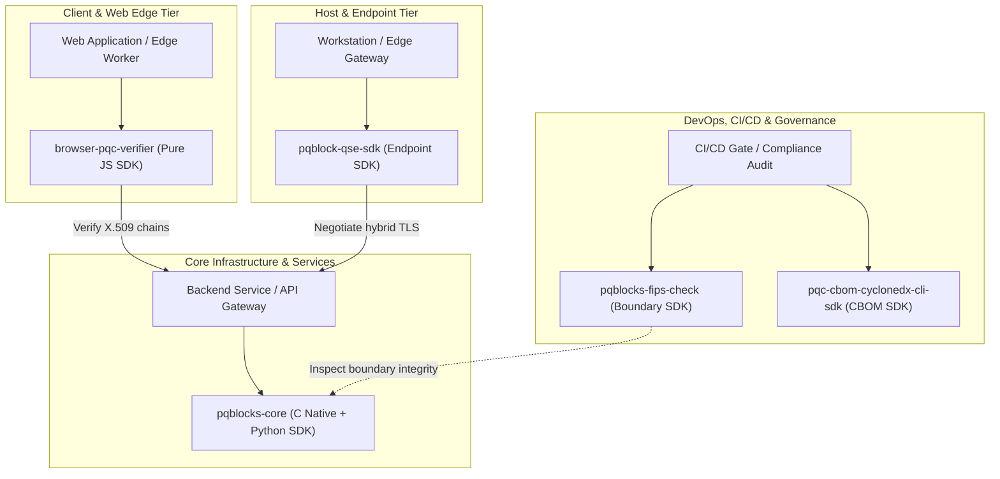

# :material-cube-scan: Software Development Kits (SDKs)

<p class="pqb-lead">End-to-end developer kits bundling native acceleration, client-side runtimes, multi-language interfaces, and policy governance across backend, browser, and endpoint environments.</p>

While individual PQBlocks libraries provide narrow building blocks (such as parsing algorithm OIDs or executing isolated ACVP test vectors), **PQBlocks SDKs** provide complete developer toolkits. Each SDK targets a specific architectural tier—backend services, web browsers, security boundaries, and edge endpoints—ensuring developers can implement quantum safety without assembling disparate low-level primitives by hand.

---

## SDK Portfolio Matrix

Select the SDK tailored to your runtime environment and workload:

| SDK | Platform / Runtime | Primary Scope | Status | Repository |
|---|---|---|:---:|---|
| **[`pqblocks-core`](core.md)** | Python + Native C | Core hybrid KEM (ML-KEM-768 + X25519) and composite signatures (ML-DSA-65 + Ed25519) with C-speed shared libraries. | **Live** | [`PQBlocks/hybrid-sdk`](https://github.com/PQBlocks/hybrid-sdk) |
| **[`pqblocks-qse-sdk`](qse-sdk.md)** | Python (>=3.11) | Post-Quantum Cryptography SDK: Unified FIPS 203 (ML-KEM), FIPS 204 (ML-DSA), and FIPS 205 (SLH-DSA) façades with ACVP corpus generation. | **Live** | [`PQBlocks/pqblock-qse-sdk`](https://github.com/PQBlocks/pqblock-qse-sdk) |
| **[`pqblocks-browser-pqc-verifier`](browser-pqc-verifier.md)** | Browser / Edge / Node.js | Pure JavaScript/TypeScript client SDK for validating post-quantum X.509 chains, ML-DSA, and SLH-DSA certificates. | **Live** | [`PQBlocks/browser-pqc-verifier`](https://github.com/PQBlocks/browser-pqc-verifier) |
| **[`pqblocks-fips-check`](fips-check.md)** | Python CLI & Library | Cryptographic boundary validator and dual-mode hybrid exchange conformance engine. | **Live** | [`PQBlocks/fips-boundary-validator`](https://github.com/PQBlocks/fips-boundary-validator) |
| **`pqc-cbom-cyclonedx-cli-sdk`** | TypeScript & Python | Programmatic SDK for CycloneDX 1.6 CBOM generation, CNSA 2.0 readiness scoring, and CI gates. | *In Development* | [Roadmap](#upcoming-sdk-roadmap) |
| **`pqc-attestation-sdk`** | Python & Rust | Hardware enclave attestation quote verification and post-quantum token derivation. | *Planned* | [Roadmap](#upcoming-sdk-roadmap) |

---

## Architecture: SDK vs Modular Libraries

PQBlocks provides both full-featured SDKs and modular building blocks. The diagram below illustrates how the SDKs span across client, network, and backend layers:



---

## Live SDKs (Available on GitHub)

### 1. Core Cryptography SDK: [`pqblocks-core`](core.md) (`hybrid-sdk`)

The foundational backend SDK for native, high-throughput hybrid cryptography:

* **Dual-Layer Engine:** Native C shared libraries (`libpqblocks_kem.so`, `libpqblocks_sig.so`) bound to Python with `ctypes`.
* **Hybrid Standards:** Implements NIST FIPS 203 (ML-KEM-768 + X25519) and NIST FIPS 204 (ML-DSA-65 + Ed25519).
* **Enterprise C Headers:** Ships standard C headers (`pqblocks_kem.h`, `pqblocks_sig.h`, `pqblocks_policy.h`, `pqblocks_hsm.h`) and CMake build configurations.
* **Active Governance:** Enforces cryptographic agility policies to prevent silent downgrades to classical-only cryptography.

```bash
pip install git+https://github.com/PQBlocks/hybrid-sdk
```

---

### 2. Browser & Web Edge SDK: [`pqblocks-browser-pqc-verifier`](browser-pqc-verifier.md) (`browser-pqc-verifier`)

Client-side post-quantum cryptographic validation for web browsers and edge runtimes:

* **Zero Native Dependencies:** Pure JavaScript/TypeScript implementation executing in modern browsers, Cloudflare Workers, and Node.js.
* **Certificate Chain Validation:** Validates ML-DSA-44/65/87 and SLH-DSA X.509 certificate chains directly in client browsers.
* **Web Middleware:** Pre-packaged authentication middleware for Express and Node.js servers.
* **High Efficiency:** Sub-millisecond verification times without WASM overhead.

```bash
npm install @pqblocks/browser-pqc-verifier
```

---

### 3. FIPS Boundary & Conformance SDK: [`pqblocks-fips-check`](fips-check.md) (`fips-boundary-validator`)

Automated cryptographic boundary inspection, conformance verification, and hybrid key exchange:

* **Boundary Verification:** Inspects codebases and API interfaces for strict FIPS 203/204 boundary separation.
* **Dual-Mode Exchange:** High-level hybrid encapsulation with context-bound ML-DSA-65 signatures.
* **Known Answer Testing:** Bundles regression harnesses and Known Answer Test (KAT) suites.
* **CycloneDX CBOM Output:** Automatically generates Cryptographic Bill of Materials inventories.

```bash
pip install pqblocks-fips-check
```

---

### 4. Post-Quantum Cryptography SDK: [`pqblocks-qse-sdk`](qse-sdk.md) (`pqblock-qse-sdk`)

Unified post-quantum cryptography SDK providing standard façades for NIST FIPS 203, FIPS 204, and FIPS 205:

* **Unified Cryptographic Façades:** High-level `keypair()`, `encapsulate()`, `decapsulate()`, `sign()`, and `verify()` across ML-KEM-512/768/1024, ML-DSA-44/65/87, and SLH-DSA variants.
* **Deterministic Test Vector Corpus:** Built-in `corpus_generate()` yielding reproducible multi-algorithm test corpora via 64-bit SplitMix PRNG and SHA-256 derivation.
* **Static Analysis AST Guard:** Built-in `harden_check_unsafe_api()` static analyzer detects deprecated classical RSA/ECC cryptography imports in codebase targets.
* **Cross-Language Interoperability:** Output equivalence verified byte-for-byte across Python, Java, and .NET.

```bash
pip install git+https://github.com/PQBlocks/pqblock-qse-sdk
```

---

## SDK Quickstarts

=== "Core SDK (Python)"

    ```python title="Native hybrid KEM initialization"
    import ctypes, os
    import pqblocks_core

    # Locate and bind to the native hybrid KEM library
    lib_path = os.path.join(os.path.dirname(pqblocks_core.__file__), "lib", "libpqblocks_kem.so")
    lib = ctypes.CDLL(lib_path)
    lib.PQBLOCKS_KEM_X25519_MLKEM768_new.restype = ctypes.c_void_p

    # Initialize hybrid KEM handle (ML-KEM-768 + X25519)
    kem = lib.PQBLOCKS_KEM_X25519_MLKEM768_new()
    assert kem is not None
    print("PQBlocks hybrid core initialized successfully.")
    ```

=== "QSE SDK (Python)"

    ```python title="Unified ML-KEM & ML-DSA quickstart"
    from pqblocks_qse_sdk import keypair, encapsulate, decapsulate, sign, verify

    # 1. Key encapsulation (ML-KEM-768)
    pk_kem, sk_kem = keypair("ml-kem-768")
    ct, ss_sender = encapsulate(pk_kem, "ml-kem-768")
    ss_receiver = decapsulate(sk_kem, ct, "ml-kem-768")
    assert ss_sender == ss_receiver

    # 2. Digital signature (ML-DSA-65)
    pk_sig, sk_sig = keypair("ml-dsa-65")
    sig = sign(sk_sig, b"Authenticated message", "ml-dsa-65")
    valid = verify(pk_sig, sig, b"Authenticated message", "ml-dsa-65")
    assert valid is True
    print("QSE post-quantum operations verified.")
    ```

=== "Browser SDK (JavaScript)"

    ```javascript title="Validate PQC certificate in browser/Node"
    import {
      verifyPqChain,
      loadTrustAnchorsFromPem,
    } from '@pqblocks/browser-pqc-verifier';

    // Parse trust anchors into the in-memory trust store
    const anchors = loadTrustAnchorsFromPem(rootPem);

    // Execute chain verification
    const chainPem = leafPem + '\n' + rootPem;
    const result = await verifyPqChain(chainPem, {
      trustAnchors: anchors,
      maxDepth: 5,
    });

    if (result.verified) {
      console.log('Certificate chain successfully verified!');
    }
    ```

=== "FIPS Boundary SDK (Python)"

    ```python title="Hybrid key exchange & FIPS boundary check"
    from pqblocks_fips_check import hybrid_encap, hybrid_decap, sign, verify_sig
    from pqblocks_fips_check.hybrid import hybrid_keygen

    # 1. Generate hybrid keypair (X25519 + ML-KEM-768)
    alice_pk, alice_sk = hybrid_keygen()
    bob_pk, bob_sk = hybrid_keygen()

    # 2. Encapsulate shared secret
    ct, ss_alice = hybrid_encap(bob_pk, b"session-context")

    # 3. Decapsulate and verify
    _, ss_bob = hybrid_decap(bob_sk, ct)
    assert ss_alice == ss_bob
    print("FIPS hybrid key exchange verified.")
    ```

=== "Core SDK (Native C / CMake)"

    ```bash title="Build native Core SDK"
    git clone https://github.com/PQBlocks/hybrid-sdk.git
    cd hybrid-sdk
    cmake -B build -S . && cmake --build build

    # Include in your C/C++ project:
    # #include "pqblocks_kem.h"
    # #include "pqblocks_sig.h"
    # #include "pqblocks_policy.h"
    ```

---

## Upcoming SDK Roadmap

PQBlocks is actively expanding its SDK portfolio to cover additional enterprise application surfaces:

### 1. `pqc-cbom-cyclonedx-cli-sdk` (CycloneDX CBOM & Governance SDK)
* **Target Environment:** Node.js / TypeScript & Python CLI for continuous integration (CI) and build pipelines.
* **Core Capabilities:** Programmatic API to scan source trees, binary symbols, and lockfiles to generate compliant CycloneDX 1.6 CBOM inventories. Embeds CNSA 2.0 migration countdown scoring and automated CI merge blocking.

### 2. `pqc-attestation-sdk` (Hardware Enclave & KMS Attestation SDK)
* **Target Environment:** Python & Rust applications running in confidential computing environments (AWS Nitro Enclaves, GCP Confidential Space, AMD SEV-SNP).
* **Core Capabilities:** Validates ML-DSA signed hardware enclave quotes and enables post-quantum key derivation rooted in hardware trust anchors.

---

## Extensibility & Contribution

All PQBlocks SDKs adhere to rigorous engineering standards:

* **Dual Verification:** Each SDK ships full Known Answer Tests (KAT), regression suites, and automated quickstart verification.
* **Zero Secret Leakage:** Designed with strict memory hygiene, constant-time execution paths, and memory zeroization.
* **Permissive Licensing:** Released under the Apache-2.0 license for unrestricted commercial and open-source adoption.
