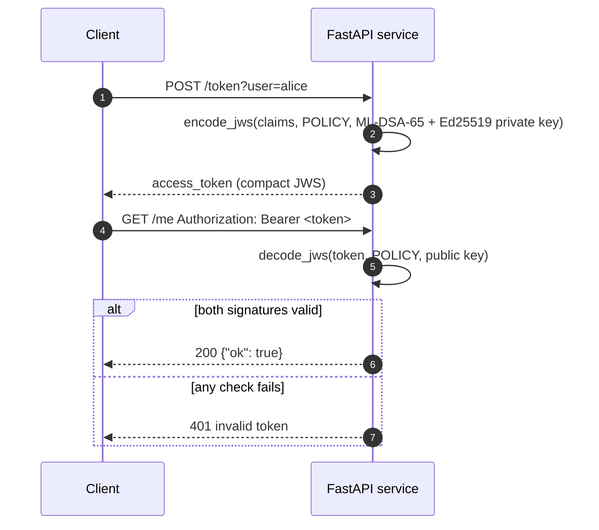

# How to add post-quantum tokens to FastAPI

<p class="pqb-lead">A FastAPI service that issues bearer tokens signed with hybrid ML-DSA-65 + Ed25519 and rejects any token that fails verification. The file runs its own self-check with FastAPI's test client.</p>

## The problem

Most FastAPI authentication uses JWTs signed with HS256, RS256 or ES256. RS256 and ES256 rely on RSA and elliptic curves, which a quantum computer breaks. You want the same bearer-token flow with signatures that stay unforgeable, without changing how clients send the token.

## Install

```bash
pip install fastapi httpx git+https://github.com/PQBlocks/hybrid-jose
```

`httpx` is only needed for the self-check at the bottom of the file.

## Complete working code

```python title="fastapi_pqc.py"
--8<-- "recipes/code/fastapi_pqc.py"
```

Run the self-check with `python fastapi_pqc.py`, or serve it with `uvicorn fastapi_pqc:app`. Output of the self-check:

```text
issued, accepted, tampered token rejected: OK
```

## How it works



1. `/token` signs the claims with the service's composite private key.
2. `verified_token` is a FastAPI dependency: it decodes the bearer token against the pinned `POLICY` and the public key, and turns every failure into `401`.
3. Any route that depends on `verified_token` is protected; the handler only runs for a valid token.

## Things to know

- **Load keys, do not generate them per process.** With several workers, each would otherwise have its own key and reject the others' tokens. Load the private key from a secret store at start-up and share the public key with verifiers.
- **Token size.** Hybrid ML-DSA-65 tokens are about 4.6 KB. Raise header limits on proxies (for example nginx `large_client_header_buffers`) if needed.
- **Add the usual JWT checks.** This recipe shows the signature layer. Add expiry (`exp`), audience and issuer checks for your application.

## Related

- [How to sign JWTs with ML-DSA in Python](jwt-ml-dsa.md)
- [`pqblocks-jose`](../packages/jose.md) · [`pqblocks-policy`](../packages/policy.md)
