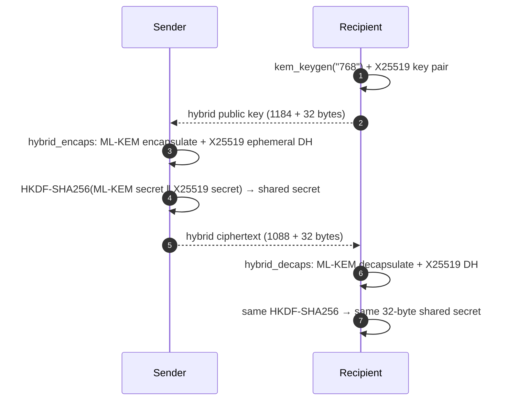

# How to do hybrid X25519 + ML-KEM key exchange in Python

<p class="pqb-lead">Combine ML-KEM-768 (FIPS 203) with X25519 so two parties agree on a 32-byte secret that stays safe if either algorithm is broken. Uses <code>pqblocks-primitives</code>.</p>

## The problem

Key exchange is the part of cryptography most exposed to *harvest now, decrypt later*: an attacker who records an X25519 or RSA key exchange today can recover the session key once a quantum computer exists. ML-KEM fixes that, but it is new. A hybrid combines both, so the result is at least as strong as the stronger of the two. This is the same construction TLS 1.3 uses in the `X25519MLKEM768` group.

## Install

```bash
pip install git+https://github.com/PQBlocks/fips-pqc-primitives
```

ML-KEM comes from [liboqs](https://openquantumsafe.org/liboqs/); see the [package page](../packages/primitives.md#install).

## Complete working code

```python title="hybrid_kem.py"
--8<-- "recipes/code/hybrid_kem.py"
```

Output:

```text
public key 1216 B | ciphertext 1120 B | shared secret 32 B
```

## How it works



| Component | ML-KEM-768 | X25519 | Hybrid |
|---|---:|---:|---:|
| Public key | 1,184 B | 32 B | **1,216 B** |
| Private key | 2,400 B | 32 B | **2,432 B** |
| Ciphertext | 1,088 B | 32 B | **1,120 B** |
| Shared secret | 32 B | 32 B | **32 B** (after HKDF) |

Both secrets feed one HKDF-SHA256 combiner, so an attacker must recover **both** to learn the output.

## Things to know

- Use the shared secret as key material for an AEAD such as AES-256-GCM or ChaCha20-Poly1305. Do not use it directly as a password or log it.
- Choose ML-KEM-1024 (`"1024"`) where policy requires it; CNSA 2.0 specifies ML-KEM-1024 for national security systems.
- For TLS, do not hand-build this: use a TLS stack with `X25519MLKEM768` and check it with [`pqblocks-tls-interop`](../packages/tls-interop.md).

## Related

- [`pqblocks-primitives`](../packages/primitives.md) · [`pqblocks-core`](../packages/core.md) (native hybrid SDK) · [`pqblocks-files`](../packages/files.md)
