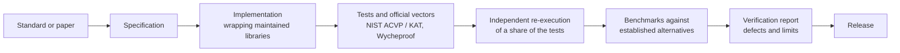

# How PQBlocks verifies its packages

<p class="pqb-lead">Every package carries its own evidence. You should be able to check each claim on a package page against a file in its repository, and re-run it.</p>

## Verified, never "certified"

In cryptography, *certified* and *validated* mean a government-accredited laboratory evaluated a module, for example under FIPS 140-3 in NIST's Cryptographic Module Validation Program (CMVP). PQBlocks packages have not been through such an evaluation. Calling self-tested open-source code "certified" would mislead the auditors and security teams who rely on that word. So PQBlocks says **verified**: tested by its authors, against official vectors where they exist, with the evidence published.

## The evidence set

| Document | What it answers |
|---|---|
| `README.md` | What the package does, when to use it, the standard it follows, install and API |
| `TESTING.md` | Which tests and vectors run, coverage, and what is **not** covered |
| `BENCHMARKS.md` | Measured performance against alternatives, including where the package loses |
| `EVIDENCE.md` | Primary sources (standards, papers) and a map from each method to the code that implements it |
| `VERIFICATION_REPORT.md` | Self-verification results, defects found and fixed, known limitations |
| `SECURITY_NOTES.md` | What it protects against, hostile-input handling, constant-time, RNG and audit status |
| `USE_CASES.md` | Worked scenarios, and when to pick something else |
| `AGENTS.md` | Correct imports and pitfalls for AI coding assistants |
| `CHANGELOG.md` | Every release and what changed |

Each package page links its set under **Documentation and evidence**.

## How the evidence is produced



1. **Official vectors are the reference.** Where NIST ACVP, KAT or Wycheproof vectors exist, they are vendored byte-for-byte with their source and checked in tests.
2. **Tests are re-executed independently** before a release, and the result is recorded in the verification report.
3. **Benchmarks are honest.** They compare against established libraries and publish the cases where PQBlocks is slower.
4. **Documentation is executed.** The quickstarts and recipes on this site are run against the package source before publishing; see [recipes](../recipes/index.md).

## Reproduce it yourself

Each `TESTING.md` gives the exact commands. The pattern is the same everywhere:

```bash
git clone https://github.com/PQBlocks/<repository>
cd <repository>
pip install -e ".[test]"
pytest
```
