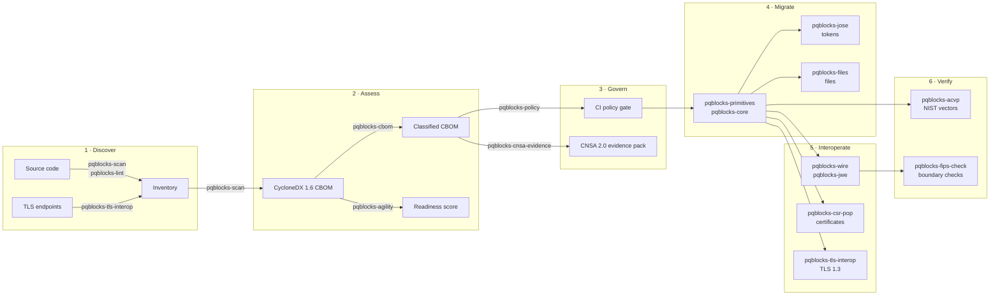

# The post-quantum transition, mapped

Moving off RSA and elliptic curves is a multi-year engineering programme, not a library upgrade. This page maps each step to the package that does the work and to the deadlines that set the pace.

## How do the steps connect?

## What happens at each step?

| Step | Question it answers | Packages |
|---|---|---|
| **1. Discover** | Where do we use RSA, ECC, weak hashes and post-quantum algorithms, in code and on the wire? | [`scan`](packages/scan.md), [`lint`](packages/lint.md), [`tls-interop`](packages/tls-interop.md) |
| **2. Assess** | How exposed are we, and how hard will the change be? | [`cbom`](packages/cbom.md), [`agility`](packages/agility.md) |
| **3. Govern** | How do we stop new classical-only code and prove progress to auditors? | [`policy`](packages/policy.md), [`jwe-audit`](packages/jwe-audit.md), [`cnsa-evidence`](packages/cnsa-evidence.md) |
| **4. Migrate** | What replaces the old primitives in tokens, files and key exchange? | [`primitives`](packages/primitives.md), [`core`](packages/core.md), [`jose`](packages/jose.md), [`files`](packages/files.md) |
| **5. Interoperate** | How do larger keys, ciphertexts and signatures travel through protocols and formats? | [`tls-interop`](packages/tls-interop.md), [`wire`](packages/wire.md), [`jwe`](packages/jwe.md), [`csr-pop`](packages/csr-pop.md) |
| **6. Verify** | Is the new implementation correct, and did the migration actually land? | [`acvp`](packages/acvp.md), [`fips-check`](packages/fips-check.md) |

## Which deadlines drive the timeline?

| Date | Milestone | Source |
|---|---|---|
| **Aug 2024** | ML-KEM, ML-DSA and SLH-DSA published as final standards (FIPS 203, 204, 205) | NIST |
| **2025** | CNSA 2.0: software and firmware signing, web browsers, servers and cloud services should support and prefer CNSA 2.0 algorithms | NSA CNSA 2.0 |
| **2026–2027** | CNSA 2.0: traditional networking equipment (2026) and operating systems (2027) should support and prefer CNSA 2.0 | NSA CNSA 2.0 |
| **End of 2026** | EU member states start the transition and complete first inventories | EU coordinated PQC roadmap (2025) |
| **2030** | 112-bit quantum-vulnerable algorithms (for example RSA-2048, P-256) deprecated. CNSA 2.0: software/firmware signing and networking equipment use CNSA 2.0 exclusively. EU: high-risk use cases migrated | NIST IR 8547 (draft), NSA CNSA 2.0, EU roadmap |
| **2033** | CNSA 2.0: browsers, servers, cloud services and operating systems use CNSA 2.0 exclusively | NSA CNSA 2.0 |
| **2035** | All quantum-vulnerable public-key algorithms disallowed; national security systems quantum-resistant | NIST IR 8547 (draft), NSM-10 |

!!! info "Read the primary sources"
    Deadlines differ by sector and system type, and drafts change. Plan against the documents themselves: [NIST IR 8547](https://csrc.nist.gov/pubs/ir/8547/ipd), [NSA CNSA 2.0](https://media.defense.gov/2022/Sep/07/2003071834/-1/-1/0/CSA_CNSA_2.0_ALGORITHMS_.PDF) and the [FIPS 203](https://csrc.nist.gov/pubs/fips/203/final), [204](https://csrc.nist.gov/pubs/fips/204/final) and [205](https://csrc.nist.gov/pubs/fips/205/final) standards.

## Where do I start?

Start with step 1. A complete inventory turns a vague mandate into a list of concrete changes. Follow [How to check if my app still uses RSA or ECC](recipes/crypto-audit.md), then work through the steps in order.
