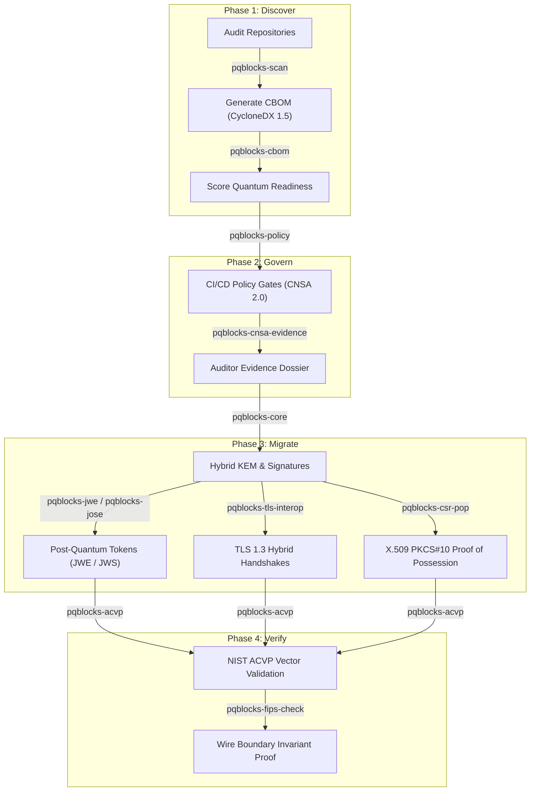

# The Post-Quantum Transition Mapped

The migration away from RSA and ECC is a multi-year engineering program. PQBlocks provides tools for every phase of the transition.

## Transition Timeline & Regulatory Milestones

| Year | Standard / Mandate | What Changes | Relevant PQBlocks Tool |
|---|---|---|---|
| **2024** | NIST FIPS 203, 204, 205 | Initial PQC standards finalized | `pqblocks-core`, `pqblocks-acvp` |
| **2026** | NSA CNSA 2.0 (Phase 1) | Software & firmware signing begins PQC migration | `pqblocks-policy`, `pqblocks-cnsa-evidence` |
| **2030** | NIST SP 800-131A Rev 3 | RSA-2048 and classical ECC deprecated | `pqblocks-scan`, `pqblocks-lint` |
| **2033** | NSA CNSA 2.0 (Phase 2) | Exclusively quantum-safe cryptography mandatory | `pqblocks-cbom`, `pqblocks-jwe` |
